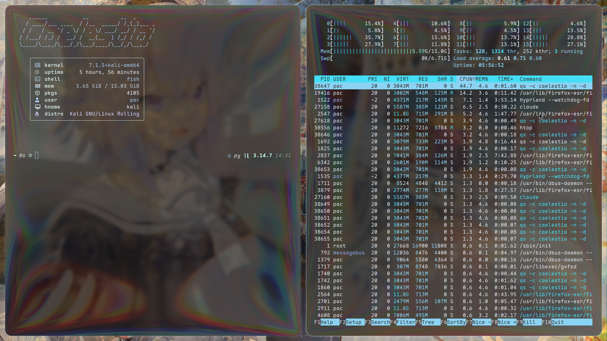

# 🪐 Caelestia × Kali — Dotfiles




Reconstruction complète de mon environnement **Hyprland + Caelestia** sur une
**Kali Linux standard** : réglages visuels, animations, barre (hotbar), raccourcis
clavier, thèmes GTK/Qt, terminaux et prompt.

> Basé sur le thème r/unixporn de u/Minty_Stellar (Caelestia + Hyprglass), adapté
> à Kali/Debian (AZERTY, iGPU AMD, qt6ct/Kvantum à la place de qtengine).

---

## ⚡ Installation rapide

```bash
git clone https://github.com/sapeurpac/caelestia-kali-dotfiles.git
cd caelestia-kali-dotfiles
./install.sh --deps        # installe les paquets apt + pose les dotfiles
```

- `./install.sh`           → pose les dotfiles en **symlinks** (sauvegarde l'existant)
- `./install.sh --copy`    → copie les fichiers au lieu de symlinks
- `./install.sh --deps`    → installe en plus les paquets `apt` disponibles

L'ancienne config est sauvegardée dans `~/.config-backup-<date>` (rien n'est écrasé
sans copie de secours).

---

## 🧩 Ce qui est inclus

| Domaine            | Fichiers                                             |
|--------------------|------------------------------------------------------|
| Hyprland (base)    | `config/hypr/` (modules Lua : animations, règles, keybinds…) |
| Caelestia (perso)  | `config/caelestia/hypr-user.lua`, `hypr-vars.lua`, `shell.json` |
| Terminal           | `config/foot/foot.ini`, `config/kitty/kitty.conf`    |
| Lanceur            | `config/fuzzel/fuzzel.ini`                           |
| Shell              | `config/fish/` + prompt `config/starship.toml`       |
| Moniteur / audio   | `config/btop/`, `config/cava/config`                 |
| Infos système      | `config/fastfetch/config.jsonc`                      |
| Thèmes GTK         | `config/gtk-3.0/`, `config/gtk-4.0/` (Arc-Dark + candy-icons) |
| Thèmes Qt          | `config/qt6ct/`, `config/Kvantum/` (KvArcDark)       |

**Pas inclus** (volontaire) :
- 🔒 aucun secret (clés, tokens, historique) — dépôt purement cosmétique ;
- 🖼️ les fonds d'écran (1,2 Go d'art tiers) — voir [`wallpapers/README.md`](wallpapers/README.md) ;
- 🔁 l'état généré (`scheme/current.*`, `apps.sqlite`, caches, `.bak`).

---

## 🎨 Le stack visuel

- **Compositeur** : Hyprland, config en **Lua** (API Caelestia, pas de `hyprland.conf`).
- **Shell / barre / panneaux** : [Caelestia](https://github.com/caelestia-dots/shell)
  (sur [Quickshell](https://quickshell.outfoxxed.me/)).
- **Material You dynamique** : `autowall.sh` → Caelestia régénère barre, bordures
  Hyprland, GTK/Qt, btop et terminaux à partir du fond d'écran ; **pywal** fait kitty.
- **Effet verre** : Hyprglass (plugin Hyprland), *opt-in* via le fichier
  `~/.config/caelestia/hyprglass.enable`.
- **Transparence** : `shell.json` (`base 0.55`, `layers 0.35`) + foot `alpha=0.1`
  + kitty `background_opacity 0.7`.
- **Animations** : courbes bézier `easeOutQuint`/`easeInOutCubic`… dans
  `config/caelestia/hypr-user.lua` (fenêtres, calques, workspaces, zoom).
- **Polices** : Google Sans Flex (UI), Maple Mono NF (mono), JetBrains Mono NF (lanceur).

---

## ⌨️ Raccourcis clés (Super = touche Windows)

> Clavier **AZERTY** : les bureaux se changent avec les touches `& é " ' ( - è _ ç à`
> (voir le bloc AZERTY dans `hypr-user.lua`). Référence complète dans
> `config/hypr/variables.lua`.

| Action                    | Raccourci                 |
|---------------------------|---------------------------|
| Lanceur d'apps            | `Super` (seul)            |
| Terminal (foot)           | `Super + T`               |
| Navigateur                | `Super + W`               |
| Éditeur                   | `Super + C`               |
| Explorateur de fichiers   | `Super + E`               |
| Fermer la fenêtre         | `Super + Q`               |
| Plein écran               | `Super + F`               |
| Flottant on/off           | `Super + Alt + Espace`    |
| Déplacer / redimensionner | `Super + Z` / `Super + X` |
| Bureaux 1→10              | `Super + <touche AZERTY>` |
| Changer de fond + thème   | `Super + Shift + W`       |
| Capture d'écran           | `Impr. écran`             |
| Capture région (gelée)    | `Super + Shift + S`       |
| Presse-papier (historique)| `Super + V`               |
| Émojis                    | `Super + .`               |
| Barre latérale / panneaux | `Super + N` / `Super + K` |
| Verrouiller               | `Super + L`               |
| Veille                    | `Super + Shift + L`       |
| Menu session              | `Ctrl + Alt + Suppr`      |

---

## 🛠️ Étapes manuelles (hors dépôts apt Kali)

`install.sh --deps` installe tout ce qui est packagé. Le reste se compile / s'installe
à la main :

1. **Quickshell** puis **Caelestia shell + CLI** — https://github.com/caelestia-dots/shell
   (le cœur de la barre, des panneaux et du moteur de thème Material You).
2. **Hyprglass** (effet verre, optionnel) — compilé pour ta version d'Hyprland, placé
   dans `~/.local/share/hyprglass/hyprglass.so`, puis :
   ```bash
   touch ~/.config/caelestia/hyprglass.enable
   ```
3. **Polices** : Maple Mono NF, JetBrains Mono NF (Nerd Fonts) + Google Sans Flex.
4. **Icônes / curseur** : `candy-icons`, curseur `sweet-cursors` (sinon Adwaita, déjà géré).
5. **starship** :
   ```bash
   curl -sS https://starship.rs/install.sh | sh
   ```
6. **Fonds d'écran** : dépose tes images dans `~/Pictures/wallpaper/` puis `Super + Shift + W`.

---

## 🧯 Dépannage

- **Écran figé sur iGPU AMD** : les curseurs matériels sont désactivés
  (`no_hardware_cursors = true` dans `hypr-user.lua`).
- **pywal cassé** :
  ```bash
  rm -rf ~/.local/pywal_venv
  python3 -m venv ~/.local/pywal_venv
  ~/.local/pywal_venv/bin/pip install pywal
  ```
- **Thème qui « revient en arrière »** : normal, Caelestia réécrit les couleurs après
  pywal ; `autowall.sh` utilise `-s` sous Hyprland pour éviter le conflit.
- **Tout revenir en arrière** : ta config d'origine est dans `~/.config-backup-<date>`.

---

## 📜 Crédits

- [Caelestia](https://github.com/caelestia-dots/shell) — dotfiles & shell Quickshell.
- Thème verre d'après u/Minty_Stellar (r/unixporn).
- Fonds d'écran : œuvres de leurs auteurs respectifs (non redistribuées ici).
